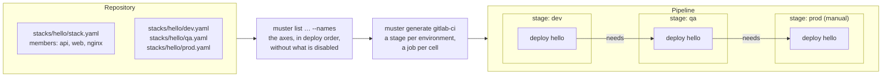
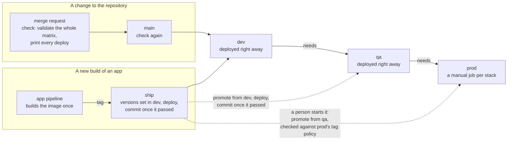

# Matrix deployments

How Muster turns "deploy this" into the right set of deployments across environments, stacks and apps, and the continuous delivery principles behind it. The commands are in the [README](README.md#matrix-deployments); the rules are in [CONCEPT.md](CONCEPT.md#matrix-deployment).

## The matrix

A system of several apps, deployed together as stacks, into several environments, has three axes:

```
                    stack hello                       stack shop
               ┌──────────┬──────────┬──────────┐  ┌──────────┬──────────┐
               │   api    │   web    │  nginx   │  │   web    │    db    │
       ┌───────┼──────────┼──────────┼──────────┤  ├──────────┼──────────┤
       │ dev   │   helm   │   helm   │   helm   │  │   helm   │   helm   │
       │ qa    │   mock   │   helm   │   helm   │  │   helm   │ external │
       │ prod  │   helm   │   helm   │   helm   │  │    —     │    —     │
       └───────┴──────────┴──────────┴──────────┘  └──────────┴──────────┘
                                                      (prod doesn't host shop)
```

Each **cell** is one app of one stack in one environment that hosts the stack: the unit Muster resolves, checks and deploys. A cell has its own mode (`helm`, `mock` or `external`), values, version and release. A matrix deployment is a selection of cells: every stack everywhere, one stack everywhere, one app wherever it runs, and so on.

The matrix isn't written down anywhere. It follows from two facts, each kept in one place:

| Fact | Where it is kept |
|---|---|
| Which apps a stack has, and in what order | `stacks/<stack>/stack.yaml` |
| Which environments host a stack, and how each member runs there | `stacks/<stack>/<env>.yaml`: the file existing means the environment hosts the stack |

Everything else, such as which stacks an app is in or where it can be deployed, is derived. `muster list` gives each axis, so a pipeline builds the matrix from the repository instead of a hand-written list.



Each job runs one `muster deploy --env <env> --stack <stack> --yes`, which deploys the stack's cells in member order.

## The principles

### One source of truth, and nothing else to keep in step

A hand-written list of environments and jobs drifts from what is deployed: someone adds an environment and forgets the pipeline, or removes an app and leaves its job. Muster's pipelines name no environment, stack or app. They ask the repository (`muster list … --names`), so adding a stack file adds the stack to every pipeline that deploys it, and disabling something removes it from them. Reviewing the repository is reviewing what will deploy.

### Build once, promote the same thing

An app's pipeline builds an image once and records its tag in the versions file of the first environment. Every later environment gets that same tag by promotion from the one before it (`muster versions promote --env qa`), never by a rebuild and never set directly. What reached production is what was tested, and each environment's versions file says exactly what runs there. An environment can refuse tags it shouldn't run, such as anything but release tags in production (`versions.tags`).

### Each environment after the one before, production on purpose

Environments form a chain: each names the one it promotes from (`promotion.from`), such as dev, then qa from dev, then prod from qa. The chain is the deploy order, and it is enforced twice:

- **Versions:** an environment takes versions only by promotion from the one before it, so a version can't skip an environment, from any pipeline or laptop.
- **Deploys:** in a generated pipeline, each deploy job needs the same stack's job in the environment before, so a stack that fails in qa never starts in prod.

Production jobs wait for a person by default (`promotion.manual`), and only the main branch can reach production at all. A branch pipeline offers only test environments.

### Small, independent units

A cell is small enough to reason about and independent of the cells in other environments, so:

- **Stacks don't wait for each other.** A stack's job in qa waits only for that stack's job in dev, so one stack failing holds up only that stack, and different stacks move along the chain at their own pace.
- **Within an environment, one thing at a time.** A queue per environment (a GitLab `resource_group`) runs two jobs in the same environment one after the other, never at once. Inside a stack, members deploy in the stack's order.
- **A failure stops only what comes after it.** A failed cell stops its own job and that stack's jobs in later environments, not the rest of the matrix. The pipeline shows which cells succeeded, and a retry reruns only the failed one.

### Every change checked against everything it touches

A change to an app's values affects every stack and environment it runs in. Before merging, `muster validate` resolves the whole matrix: every member's mode, every dependency met by exactly one member, every release name unique and within Helm's limits. The merge request's pipeline then prints every stack's deploy in every environment, as the same jobs main would run, without running them (`--yes=false`). A change that breaks a cell three environments away fails the merge request, not a production deploy.

### Repeatable deploys from desired state

The repository is the desired state. A deploy (`helm upgrade --install`) converges a cell to it, and running it again changes nothing. The same command runs on a laptop and in CI: `muster deploy --env qa --stack hello --yes`. A rollback in the cluster is for emergencies only, because the next deploy brings back what the repository records. A lasting rollback is a commit.

### Explicit scope, no surprises

A command names what it acts on (`--env`, `--stack` or `--all-stacks`, optionally `--app`) and means the same thing after the repository grows. When a name is wrong, Muster stops and lists the valid names instead of skipping it. Selecting an app deploys only that app, never the dependencies Muster assumes are already there.

### Parity, with the differences visible

Every environment runs every member of every stack it hosts, from the same app definitions. Where an environment differs, the difference is one line in its stack file: a member that is a `mock` in qa, `external` in production (a managed database, say), or a different provider for the same slot. Nothing is left out quietly, so "it works in qa" means the same parts were there.

### Stop a cell without deleting it

An environment, a stack in an environment, or one member can be disabled, with a required reason. It drops out of every matrix (`list --names` leaves it out, so no job is created), and naming it directly is refused. Its files stay, and enabling it again brings it back.

## How a change moves through the matrix

Two kinds of change reach the matrix: a change to the repository (values, stacks, environments), and a new build of an app.



1. **Check:** every merge request and every commit on main runs `muster validate` and prints every deploy, so a change that breaks any cell fails before it merges.
2. **Deploy from main:** main deploys every stack, a stage per environment in deploy order, each stack's job after its job in the environment before: the test environments right away, production as manual jobs.
3. **Ship:** an app's pipeline triggers a ship with the new tag. It sets the tag where the chain starts (dev) and deploys the app; only when that passes does it commit. Then each environment in turn promotes from the one before, deploys and commits, until a manual one (prod), which waits for a person. A deploy that fails commits nothing, so the environment's versions file keeps what last passed, and nothing after it starts.
4. **Promote:** a person, or a schedule (nightly into qa, say), promotes along the chain without a new build: each environment copies what passed in the one before, prod checks it against its tag policy, and each commits once its deploy passed.

Because a versions file is committed only after its deploy passed, a version in an environment's file means it passed there. Whatever starts a promotion, automatically, by hand or on a schedule, it copies only what passed.

## Push, not reconcile

Muster deploys a matrix when a pipeline asks it to, then stops. It doesn't watch the cluster and correct drift, as a GitOps controller does (Argo CD's ApplicationSets generate a similar matrix and keep reconciling it). Both are continuous delivery: Muster's pipelines are the delivery, and the repository stays the record of what should run. An environment owned by a GitOps controller is marked `gitops: true`, and Muster then leaves its deploys to the controller.
